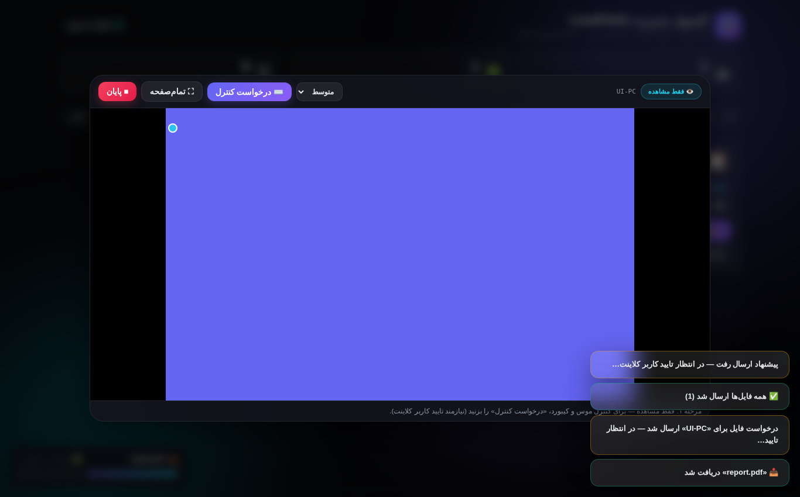
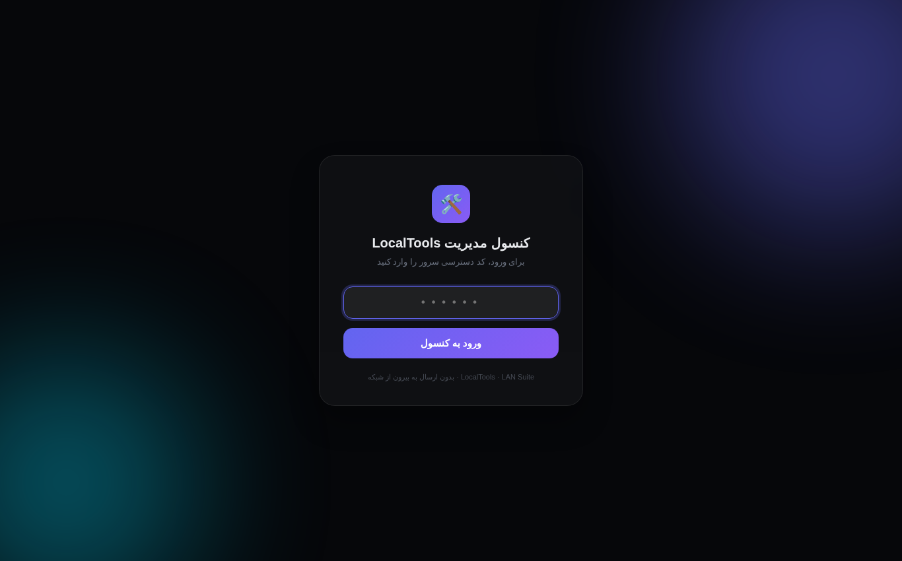

# 🛠️ LocalTools — مجموعه ابزار محلی شرکت

نسل بعدی [file_share](https://github.com/hmplus28/file_share): ابزار **همه‌جانبه شبکه محلی** برای شرکت —
**ارسال فایل با درگ‌ودراپ + اشتراک صفحه دوطرفه + کنترل از راه دور موس/کیبورد** — کاملاً داخل LAN، بدون هیچ ابری.

> همان هویت بصری و روحیه «PIN محلی» file_shareV3، اما با معماری Realtime جدید:
> سرور مرکزی + ایجنت روی هر کلاینت + کنسول وب مدیریتی.

| مشاهده صفحه کلاینت | کنسول مدیریتی | ورود |
|:---:|:---:|:---:|
|  |  |  |

---

## ✨ امکانات

- **لیست زنده کلاینت‌ها** — صفحه اصلی کنسول، همه کلاینت‌های ویندوز/لینوکسی که ایجنت دارند را با نام، کاربر، IP، وضعیت و توانایی‌ها نشان می‌دهد (به‌روزرسانی Realtime).
- **ارسال فایل با درگ‌ودراپ** — فایل را روی کارت کلاینت بکشید و رها کنید؛ یا داخل مودال ارسال. چندفایله، نوار پیشرفت زنده.
- **درخواست فایل از کلاینت** — کاربر کلاینت در پاپ‌آپ «انتخاب و ارسال» فایل می‌کند و فایل مستقیم به مرورگر شما دانلود می‌شود.
- **اشتراک صفحه کلاینت → کنسول (۲ مرحله‌ای)** — مرحله ۱ فقط مشاهده؛ مرحله ۲ با تایید جداگانه کاربر، کنترل موس و کیبورد (pynput). هر لحظه قابل رها کردن.
- **اشتراک صفحه کنسول → کلاینت** — صفحه/پنجره مرورگر شما (getDisplayMedia) در پنجره‌ای روی کلاینت نمایش داده می‌شود (فقط مشاهده).
- **تایید اجباری** — هیچ انتقال فایلی و هیچ جلسه اشتراکی بدون زدن «تایید» در پاپ‌آپ tkinter روی خود کلاینت شروع نمی‌شود. بدون تایید (یا با بی‌پاسخی بعد از ۶۰ ثانیه) درخواست می‌میرد.
- **کیفیت تصویر قابل تنظیم** — کم/متوسط/زیاد، حین جلسه هم قابل تغییر. مکان‌نمای موسِ کلاینت روی تصویر دیده می‌شود.
- **ورود با کد (PIN)** — کنسول وب با صفحه PIN قفل می‌شود؛ ایجنت‌ها با همان کد در URL احراز می‌شوند.
- **پایدار** — قطع/وصل ایجنت خودکار reconnect می‌شود و همان شناسه را نگه می‌دارد؛ heartbeat هر ۱۰ ثانیه؛ کلاینت بی‌پاسخ بعد از ~۳۰ ثانیه آفلاین می‌شود (خاکستری).

---

## 📦 راهنمای نصب کامل از روی همین ریپو (ویندوز و لینوکس)

### ۰) پیش‌نیازها

| | سرور مرکزی (۱ دستگاه) | ایجنت (هر کلاینت) |
|---|---|---|
| سیستم‌عامل | ویندوز ۱۰/۱۱ یا لینوکس | ویندوز ۱۰/۱۱ یا لینوکس (X11) |
| پایتون | ۳.۹ به بالا | ۳.۹ به بالا |
| نرم‌افزار دیگر | — | ویندوز: هیچ (tkinter همراه پایتون است) · لینوکس: `python3-tk` |
| شبکه | **پورت 8788** باز برای ورود از LAN | دسترسی خروجی به پورت 8788 سرور |

در همه دستورهای زیر، `1234` را با کد دسترسی خودتان و `192.168.1.10` را با IP سرور خودتان عوض کنید.

---

### ۱) دانلود پروژه از گیت‌هاب

**روش الف — با git** (در CMD/پاورشل ویندوز یا ترمینال لینوکس):

```bash
git clone https://github.com/hmplus28/local-tools.git
cd local-tools
```

**روش ب — بدون نصب git:**
1. بروید به `https://github.com/hmplus28/local-tools`
2. دکمه سبز **Code** → **Download ZIP**
3. فایل ZIP را استخراج کنید (مثلاً در `C:\local-tools` یا `~/local-tools`)

ساختار بعد از دانلود:

```
local-tools/
├── server/          ← روی دستگاه سرور اجرا می‌شود
├── agent/           ← روی هر کلاینت ویندوز/لینوکس اجرا می‌شود
├── webconsole/      ← کنسول وب (سرور خودش سرو می‌کند؛ کاری با آن ندارید)
├── tests/           ← تست‌های خودکار
└── docs/            ← مستندات (PROTOCOL / DEPLOY / TESTING / ANALYSIS)
```

---

### ۲) نصب و اجرای سرور مرکزی

#### 🪟 روی ویندوز

**گام ۱ — نصب پایتون** (اگر ندارید):
1. از [python.org/downloads](https://www.python.org/downloads/) آخرین نسخه را بگیرید و نصب کنید.
2. در صفحه اول نصب، تیک **«Add python.exe to PATH»** را حتماً بزنید.
3. بررسی: CMD را باز کنید و بنویسید `python --version` — باید مثلاً `Python 3.12.x` چاپ شود.

**گام ۲ — نصب وابستگی‌ها و اجرا** (CMD یا PowerShell):

```bat
cd C:\local-tools\server
python -m pip install -r requirements.txt
python server.py --port 8788 --code 1234 --ssl
```

- اولین بار که اجرا کنید، ویندوز پنجره **Windows Security / فایروال** نشان می‌دهد → **Allow access** بزنید.
- بعد از اجرا، بنر زیر چاپ می‌شود؛ نشانی کنسول و نشانی ایجنت‌ها را از همان‌جا بردارید:

```
================================================================
  LocalTools Hub — سرور مرکزی ابزار شرکت
  نشانی کنسول وب : https://192.168.1.10:8788/
  نشانی ایجنت‌ها : https://192.168.1.10:8788/ws?role=agent&code=1234
================================================================
```

- اجرای دائمی/خودکار: یک Task در Task Scheduler بسازید (Action: `python server.py --port 8788 --code 1234 --ssl`، Trigger: At startup). برای سرویس systemd لینوکسی و جزئیات بیشتر `docs/DEPLOY.md` را ببینید.

#### 🐧 روی لینوکس

**گام ۱ — بسته‌های سیستم** (اگر ندارید):

```bash
# Ubuntu / Debian:
sudo apt update && sudo apt install -y git python3 python3-venv python3-pip python3-tk

# Fedora / RHEL / Alibaba:
sudo dnf install -y git python3 python3-pip python3-tkinter
```

**گام ۲ — نصب وابستگی‌ها و اجرا** (داخل محیط مجازی — اجباری نیست ولی از خطای `externally-managed-environment` در توزیع‌های جدید جلوگیری می‌کند):

```bash
cd ~/local-tools/server
python3 -m venv .venv
source .venv/bin/activate
pip install -r requirements.txt
python server.py --port 8788 --code 1234 --ssl
```

**گام ۳ — باز بودن پورت:**

```bash
sudo ufw allow 8788/tcp     # Ubuntu (اگر ufw فعال است)
# یا در firewalld:
sudo firewall-cmd --permanent --add-port=8788/tcp && sudo firewall-cmd --reload
```

**اجرای دائمی به‌صورت سرویس:**

```bash
sudo cp ~/local-tools/server/localtools-hub.service /etc/systemd/system/
sudo nano /etc/systemd/system/localtools-hub.service   # مسیرها و --code را ویرایش کنید
sudo systemctl daemon-reload
sudo systemctl enable --now localtools-hub
```

> داخل فایل سرویس، اگر از venv استفاده می‌کنید `ExecStart` را به مسیر پایتون venv بدهید (مثلاً `/home/user/local-tools/server/.venv/bin/python`).

#### پارامترهای مهم سرور

| پارامتر | توضیح |
|---|---|
| `--port 8788` | پورت HTTP و WebSocket (یک پورت برای همه‌چیز) |
| `--code 1234` | کد دسترسی — اگر نگذارید، کنسول بدون رمز باز می‌شود (فقط برای تست) |
| `--ssl` | **برای قابلیت «نمایش صفحه من» لازم است**؛ گواهی self-signed خودکار ساخته می‌شود (`certs/`) |

---

### ۳) ورود به کنسول وب (از هر دستگاهی در شبکه)

1. مرورگر → نشانی چاپ‌شده توسط سرور، مثلاً: `https://192.168.1.10:8788/`
2. چون گواهی self-signed است، هشدار می‌بینید:
   - **Chrome/Edge**: Advanced → **Proceed to … (unsafe)**
   - **Firefox**: Advanced → **Accept the Risk and Continue**
3. کد دسترسی (`1234`) را وارد کنید → وارد لیست کلاینت‌ها می‌شوید.

---

### ۴) نصب ایجنت روی هر کلاینت

#### 🪟 روی ویندوز

**گام ۱ — پایتون**: مثل بخش سرور، از python.org با تیک «Add python.exe to PATH» نصب کنید و با `python --version` چک کنید.

**گام ۲ — دانلود پروژه**: روی کلاینت هم همان «روش الف یا ب» بخش ۱ را انجام دهید (مثلاً پروژه در `C:\local-tools`).

**گام ۳ — نصب و اولین اجرا** (CMD):

```bat
cd C:\local-tools\agent
python -m pip install -r requirements.txt
python agent.py --server ws://192.168.1.10:8788/ws --code 1234
```

- اگر همه‌چیز درست باشد، بنر وضعیت چاپ می‌شود (`کپچر ✓ | کنترل ✓ | پاپ‌آپ GUI ✓`) و کلاینت **بلافاصله در کنسول سبز می‌شود**.
- کانفیگ در `C:\local-tools\agent\agent.json` ذخیره می‌شود (سرور/کد/شناسه) — دفعات بعد نیازی به پارامتر نیست.

**گام ۴ — از این به بعد:**

- فقط فایل **`run_agent.bat`** را دابل‌کلیک کنید (با pythonw بدون پنجره کنسول اجرا می‌شود؛ آیکنش در تری نیست چون برنامه پس‌زمینه است — پاپ‌آپ‌های تایید همان‌جا روی دسکتاپ باز می‌شوند).
- برای تست با دیدن لاگ: در CMD بنویسید `python agent.py`.

**گام ۵ — استارت خودکار با ویندوز:**

1. کلیدهای `Win + R` → بنویسید `shell:startup` → Enter
2. روی `run_agent.bat` راست‌کلیک → Create shortcut → فایل shortcut را داخل پوشه باز‌شده منتقل کنید.

**فایروال کلاینت**: فقط خروجی به پورت 8788 لازم است که به‌صورت پیش‌فرض باز است.

#### 🐧 روی لینوکس

**گام ۱ — پیش‌نیاز سیستم** (مثل بخش سرور: `python3-venv`, `python3-pip` و **حتماً `python3-tk`** برای پاپ‌آپ‌ها).

**گام ۲ — نصب و اولین اجرا:**

```bash
cd ~/local-tools/agent
python3 -m venv .venv
source .venv/bin/activate
pip install -r requirements.txt
python agent.py --server ws://192.168.1.10:8788/ws --code 1234
```

- دفعات بعد فقط: `./run_agent.sh`
- فایل‌هایی که از کنسول می‌گیرید پیش‌فرض در `~/Downloads/LocalTools` ذخیره می‌شوند (با `--save-dir` عوض کنید).

**گام ۳ — سرویس خودکار کاربر:**

```bash
cp ~/local-tools/agent/localtools-agent.service ~/.config/systemd/user/
nano ~/.config/systemd/user/localtools-agent.service   # مسیرها و نشانی سرور را ویرایش کنید
systemctl --user daemon-reload
systemctl --user enable --now localtools-agent
loginctl enable-linger $USER    # تا سرویس حتی بدون لاگین‌شدن دسکتاپ بالا بیاید
```

**⚠️ مهم در لینوکس:** کپچر صفحه و کنترل موس/کیبورد فقط در نشست **X11** کار می‌کند (mss/pynput). اگر دسکتاپ شما Wayland است، در صفحه ورود گزینه «Ubuntu on Xorg» / «GNOME on Xorg» را انتخاب کنید. در نشست Wayland ایجنت وصل می‌شود ولی بج‌های «کپچر/کنترل» ندارید.

---

### ۵) اولین تست ۵ دقیقه‌ای بعد از نصب

1. کنسول را باز کنید → کارت کلاینت باید **سبز** باشد.
2. یک فایل را **درگ‌ودراپ** کنید روی کارت → روی کلاینت پاپ‌آپ تایید باز می‌شود → تایید → پیشرفت ۱۰۰٪ → فایل در `Downloads\LocalTools` کلاینت.
3. «🖥️ مشاهده صفحه» → تایید روی کلاینت → تصویر زنده؛ بعد «⌨️ درخواست کنترل» → تایید دوم → موس/کیبورد تست کنید؛ «🔓 رها کردن کنترل».
4. «📺 نمایش صفحه من» → تایید روی کلاینت → پنجره نمایش روی کلاینت باز می‌شود.
5. «📥 درخواست فایل» → روی کلاینت «انتخاب و ارسال» → فایل در مرورگر شما دانلود می‌شود.

---

### 🔧 عیب‌یابی سریع

| مشکل | علت رایج / راه‌حل |
|---|---|
| صفحه کنسول باز نمی‌شود | سرور روشن نیست؛ IP اشتباه؛ پورت 8788 در فایروال بسته (بخش ۲ گام ۳ لینوکس / Allow در ویندوز) |
| `OSError: address already in use` هنگام اجرای سرور | نمونه قبلی سرور پورت را نگه داشته — مثلاً با **Ctrl+Z** فقط «معلق» شده (Ctrl+Z توقف نیست!). فرآیند معلق به SIGTERM گوش نمی‌دهد؛ با `pkill -9 -f server.py` ببندید و دوباره اجرا کنید. برای توقف عادی سرور همیشه **Ctrl+C** بزنید |
| هشدار گواهی مرورگر | طبیعی است (self-signed) — Proceed/Accept بزنید؛ یا گواهی شرکتی با `--certfile/--keyfile` |
| ایجنت در لیست نمی‌آید | نشانی `ws://IP:PORT/ws` یا `--code` اشتباه؛ سرور با `--code` بالا آمده ولی ایجنت بدون کد |
| «نمایش صفحه من» خطا می‌دهد | سرور را با `--ssl` اجرا کنید یا کنسول را از localhost باز کنید (محدودیت امنیتی مرورگر) |
| پاپ‌آپ تایید باز نمی‌شود (لینوکس) | `python3-tk` نصب نیست → `sudo apt install python3-tk` |
| کپچر/کنترل ندارید (لینوکس) | نشست Wayland است → با X11/XWayland لاگین کنید |
| دو خط از یک کلاینت در لیست | طبیعی نیست — ایجنت با client_id ثابت reconnect می‌شود؛ فقط اگر `agent.json` را پاک کرده باشید شناسه جدید می‌گیرد |

### 🩺 دیباگ: کنسول از سیستم دیگر باز نمی‌شود (سرور محلی جواب می‌دهد)

**گام ۱ — روی سرور، اسکریپت عیب‌یابی خودکار را اجرا کنید:**

```bash
sudo bash ~/local-tools/server/diagnose.sh 8788
```

این اسکریپت شش چک می‌زند: فرآیند سرور، گوش‌دادن روی پورت و آدرس بایند (باید `0.0.0.0` باشد نه `127.0.0.1`)، قانون فایروال، پاسخ‌گویی محلی `/health`، IPهای ماشین + URL درست، و در پایان دستورات تست سمت کلاینت را چاپ می‌کند.

**گام ۲ — روی سیستم دیگری که کنسول باز نمی‌شود، سه تست بزنید:**

```powershell
# ویندوز — PowerShell:
ping 192.168.34.155
Test-NetConnection 192.168.34.155 -Port 8788
curl.exe -kI https://192.168.34.155:8788/health
```

```bash
# لینوکس / macOS:
ping -c3 192.168.34.155
nc -zv 192.168.34.155 8788
curl -kI https://192.168.34.155:8788/health
```

**گام ۳ — نتیجه را تفسیر کنید:**

| نتیجه تست از کلاینت | معنی و اقدام |
|---|---|
| ping ناموفق + TCP ناموفق | مشکل شبکه است نه برنامه: کلاینت و سرور در یک سابنت نیستند، وای‌فای شرکت **AP/client isolation** دارد، یا VPN روی کلاینت روشن است |
| ping موفق + TCP 8788 ناموفق | فایروال سرور پورت را می‌بندد → `sudo ufw status verbose` و `sudo ufw allow 8788/tcp`؛ یا سرور خاموش است → خروجی diagnose.sh بخش ۱ و ۲ |
| TCP موفق + `/health` جواب JSON داد ولی مرورگر صفحه نمی‌آورد | مشکل مرورگر است: هشدار گواهی را Proceed/Accept نکرده‌اید، یا پروکسی/VPN مرورگر روشن است، یا مرورگر قدیمی است — با مرورگر دیگر تست کنید |
| curl موفق ولی در همان لحظه در ترمینال سرور لاگ `GET /health` چاپ نمی‌شود | ترافیک به سرور نرسیده (بند اول)؛ اگر لاگ چاپ شد و مرورگر باز نشد، مشکل حتماً سمت مرورگر است (بند سوم) |

> ترفند طلایی: **حین تست از سیستم دیگر، ترمینال سرور را نگاه کنید.** هر درخواستی که به سرور برسد فوراً در لاگ چاپ می‌شود. لاگ نیامد = مسیر شبکه/فایروال؛ لاگ آمد ولی صفحه نیامد = مرورگر کلاینت.

---

## 🧪 تست‌های خودکار

```bash
# پروتکل کامل (سرور واقعی + کلاینت‌های شبیه‌سازی‌شده) — ۲۷ سناریو
python tests/e2e_simulated_test.py

# ایجنت واقعی روی سرور مجازی Xvfb (کپچر mss + کنترل pynput + پنجره tkinter) — ۱۵ سناریو
python tests/e2e_real_agent_test.py
```

نتیجه در زمان نوشتن این ریپو: **۲۷/۲۷ + ۱۵/۱۵ + تست UI مرورگر ۱۰/۱۰ سبز** (چک‌لیست دستی: `docs/TESTING.md`).

## 📂 ساختار

```
local-tools/
├── server/          سرور مرکزی aiohttp (HTTP + WebSocket در یک پورت)
├── agent/           ایجنت کراس‌پلتفرم (کپچر mss، کنترل pynput، پاپ‌آپ tkinter)
├── webconsole/      کنسول وب (HTML/CSS/JS خالص — بدون هیچ وابستگی خارجی)
├── tests/           تست‌های E2E خودکار
└── docs/            PROTOCOL.md (قرارداد پیام‌ها) · DEPLOY.md · TESTING.md · ANALYSIS.md
```

## 🔒 امنیت

- همه اکشن‌ها **دروازه تایید** دارند؛ پاپ‌آپ روی کلاینت نشان می‌دهد چه کسی (از کدام کنسول) چه می‌خواهد.
- کنترل موس/کیبورد **جداگانه و حین جلسه** تایید می‌شود و با «رها کردن» یا پایان جلسه فوراً قطع می‌شود.
- فقط یک کنسول در لحظه کنترل دارد؛ بقیه پیام «busy» می‌گیرند.
- رله فقط داخل LAN است؛ هیچ داده‌ای بیرون نمی‌رود.

## ⚠️ محدودیت‌ها

- **لینوکس + Wayland**: کپچر و کنترل فقط روی **X11** کار می‌کند (mss/pynput). روی Wayland از نشست X11/XWayland استفاده کنید.
- «نمایش صفحه من» از مرورگر، فقط مشاهده است (مرورگر اجازه تزریق ورودی نمی‌دهد) — برای کنترل کامل یک سیستم، روی همان سیستم ایجنت اجرا کنید.
- روی LAN با HTTP، فقط دکمه «نمایش صفحه من» کار نمی‌کند (محدودیت امنیتی مرورگر) — با `--ssl` حل می‌شود.
- جزئیات بیشتر در `docs/ANALYSIS.md`.

---
بر پایه ایده و طراحی [file_share](https://github.com/hmplus28/file_share) · Hamidreza Mehrabadi
