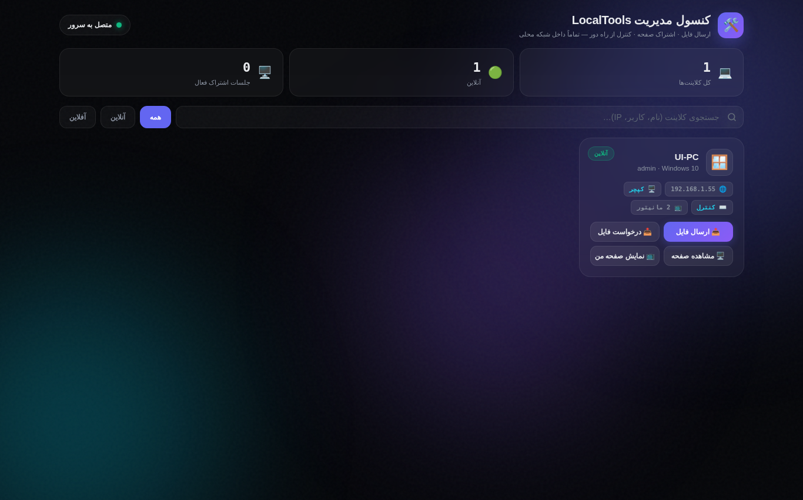

# 🛠️ LocalTools — مجموعه ابزار محلی شرکت

نسل بعدی [file_share](https://github.com/hmplus28/file_share): ابزار **همه‌جانبه شبکه محلی** برای شرکت —
**ارسال فایل با درگ‌ودراپ + اشتراک صفحه دوطرفه + کنترل از راه دور موس/کیبورد** — کاملاً داخل LAN، بدون هیچ ابری.

> همان هویت بصری و روحیه «PIN محلی» file_shareV3، اما با معماری Realtime جدید:
> سرور مرکزی + ایجنت روی هر کلاینت + کنسول وب مدیریتی.

| مشاهده صفحه کلاینت | کنسول مدیریتی | ورود |
|:---:|:---:|:---:|
|  |  |  |

---

## ✨ امکانات

- **لیست زنده کلاینت‌ها** — صفحه اصلی کنسول، همه کلاینت‌های ویندوز/لینوکسی که ایجنت دارند را با نام، کاربر، IP، وضعیت و توانایی‌ها نشان می‌دهد (به‌روزرسانی Realtime).
- **ارسال فایل با درگ‌ودراپ** — فایل را روی کارت کلاینت بکشید و رها کنید؛ یا داخل مودال ارسال. چندفایله، نوار پیشرفت زنده.
- **درخواست فایل از کلاینت** — کاربر کلاینت در پاپ‌آپ «انتخاب و ارسال» فایل می‌کند و فایل مستقیم به مرورگر شما دانلود می‌شود.
- **اشتراک صفحه کلاینت → کنسول (۲ مرحله‌ای)** — مرحله ۱ فقط مشاهده؛ مرحله ۲ با تایید جداگانه کاربر، کنترل موس و کیبورد (pynput). هر لحظه قابل رها کردن.
- **اشتراک صفحه کنسول → کلاینت** — صفحه/پنجره مرورگر شما (getDisplayMedia) در پنجره‌ای روی کلاینت نمایش داده می‌شود (فقط مشاهده).
- **تایید اجباری** — هیچ انتقال فایلی و هیچ جلسه اشتراکی بدون زدن «تایید» در پاپ‌آپ tkinter روی خود کلاینت شروع نمی‌شود. بدون تایید (یا با بی‌پاسخی بعد از ۶۰ ثانیه) درخواست می‌میرد.
- **کیفیت تصویر قابل تنظیم** — کم/متوسط/زیاد، حین جلسه هم قابل تغییر. مکان‌نمای موسِ کلاینت روی تصویر دیده می‌شود.
- **ورود با کد (PIN)** — کنسول وب با صفحه PIN قفل می‌شود؛ ایجنت‌ها با همان کد در URL احراز می‌شوند.
- **پایدار** — قطع/وصل ایجنت خودکار reconnect می‌شود و همان شناسه را نگه می‌دارد؛ heartbeat هر ۱۰ ثانیه؛ کلاینت بی‌پاسخ بعد از ~۳۰ ثانیه آفلاین می‌شود (خاکستری).

## 🚀 شروع سریع

### ۱) سرور مرکزی (روی یک سیستم لینوکسی/ویندوزی در شبکه)

```bash
pip install -r server/requirements.txt
python3 server/server.py --port 8788 --code 1234 --ssl
```

- `--code` کد دسترسی (PIN) است — هم کنسول وب هم ایجنت‌ها باید همان را داشته باشند. اگر ندید، کنسول بدون رمز باز می‌شود (فقط برای تست).
- `--ssl` **حتماً برای قابلیت «نمایش صفحه من» لازم است**؛ چون مرورگر فقط در HTTPS اجازه `getDisplayMedia` می‌دهد. گواهی self-signed خودکار ساخته می‌شود (`certs/`) — اولین باز شدن در مرورگر را Accept کنید.
- آدرس کنسول: `https://IP-SERVER:8788/`

### ۲) ایجنت روی هر کلاینت (ویندوز یا لینوکس)

```bash
pip install -r agent/requirements.txt
python agent.py --server ws://IP-SERVER:8788/ws --code 1234
```

- بار اول کانفیگ در `agent.json` کنار اسکریپت ذخیره می‌شود؛ دفعات بعد فقط `python agent.py` کافی است.
- ویندوز: `run_agent.bat` با `pythonw` بدون پنجره اجرا می‌کند.
- فایل‌های دریافتی پیش‌فرض در `Downloads/LocalTools` ذخیره می‌شوند (با `--save-dir` تغییر دهید).
- پاپ‌آپ‌های تایید (ارسال فایل / انتخاب فایل / اشتراک صفحه / کنترل) روی صفحه همان کلاینت باز می‌شوند.

### ۳) کنسول

مرورگر → `https://IP-SERVER:8788/` → کد `1234` → لیست کلاینت‌ها. تمام!

## 🧪 تست

```bash
# پروتکل کامل (سرور واقعی + کلاینت‌های شبیه‌سازی‌شده) — ۲۷ سناریو
python tests/e2e_simulated_test.py

# ایجنت واقعی روی سرور مجازی Xvfb (کپچر mss + کنترل pynput + پنجره tkinter) — ۱۵ سناریو
python tests/e2e_real_agent_test.py
```

نتیجه در زمان نوشتن این ریپو: **۲۷/۲۷ + ۱۵/۱۵ + تست UI مرورگر ۱۰/۱۰ سبز** (چک‌لیست دستی: `docs/TESTING.md`).

## 📂 ساختار

```
local-tools/
├── server/          سرور مرکزی aiohttp (HTTP + WebSocket در یک پورت)
├── agent/           ایجنت کراس‌پلتفرم (کپچر mss، کنترل pynput، پاپ‌آپ tkinter)
├── webconsole/      کنسول وب (HTML/CSS/JS خالص — بدون هیچ وابستگی خارجی)
├── tests/           تست‌های E2E خودکار
└── docs/            PROTOCOL.md (قرارداد پیام‌ها) · DEPLOY.md · TESTING.md · ANALYSIS.md
```

## 🔒 امنیت

- همه اکشن‌ها **دروازه تایید** دارند؛ پاپ‌آپ روی کلاینت نشان می‌دهد چه کسی (از کدام کنسول) چه می‌خواهد.
- کنترل موس/کیبورد **جداگانه و حین جلسه** تایید می‌شود و با «رها کردن» یا پایان جلسه فوراً قطع می‌شود.
- فقط یک کنسول در لحظه کنترل دارد؛ بقیه پیام «busy» می‌گیرند.
- رله فقط داخل LAN است؛ هیچ داده‌ای بیرون نمی‌رود.

## ⚠️ محدودیت‌ها

- **لینوکس + Wayland**: کپچر و کنترل فقط روی **X11** کار می‌کند (mss/pynput). روی Wayland از نشست X11/XWayland استفاده کنید.
- «نمایش صفحه من» از مرورگر، فقط مشاهده است (مرورگر اجازه تزریق ورودی نمی‌دهد) — برای کنترل کامل یک سیستم، روی همان سیستم ایجنت اجرا کنید.
- روی LAN با HTTP، فقط دکمه «نمایش صفحه من» کار نمی‌کند (محدودیت امنیتی مرورگر) — با `--ssl` حل می‌شود.
- جزئیات بیشتر در `docs/ANALYSIS.md`.

---
بر پایه ایده و طراحی [file_share](https://github.com/hmplus28/file_share) · Hamidreza Mehrabadi
